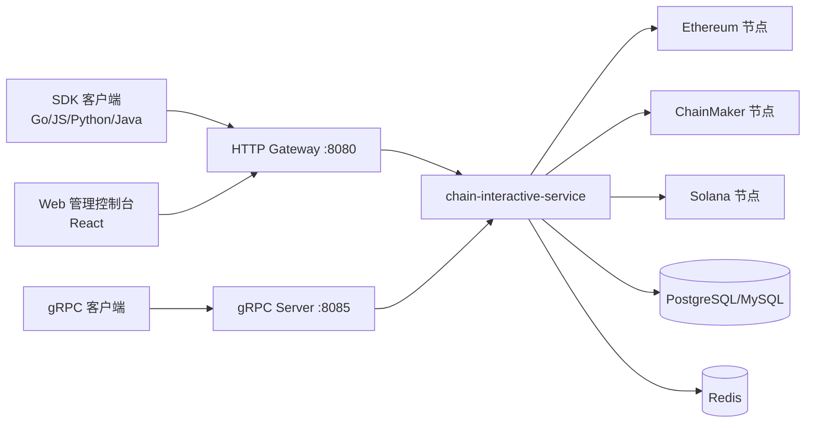
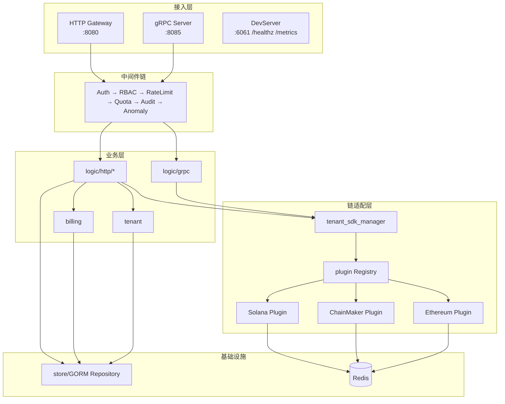
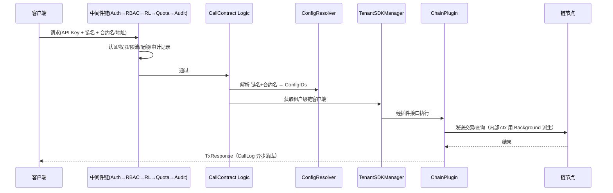
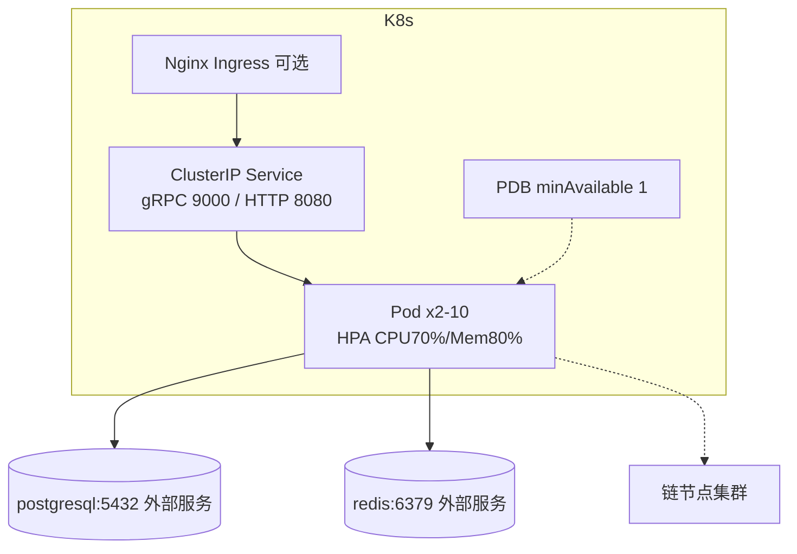

# 架构文档

> 维护者：jackz <jackz.jones@qq.com> | 最后更新：2026-11-23（sop.init 生成）

本文件面向人和 AI，描述系统结构、关键决策与已知技术债。AI 协作入口见 [AGENTS.md](../../AGENTS.md)。历史架构文档（中英双语）见 `doc/architecture_cn.md` / `doc/architecture_en.md`，本文档为 SOP 体系的权威版本。

---

## 1. 系统定位

多链区块链交互服务（BaaS）：统一 gRPC + RESTful API 与 Ethereum / ChainMaker / Solana 交互，屏蔽底层链差异；已演进为含**多租户、计费配额、插件化链适配、审计安全**的商业化平台。

**架构模式**：模块化单体（go-zero 框架，单进程内 gRPC Server + HTTP Gateway 双入口，K8s 多副本部署）。

---

## 2. 系统上下文



| 外部系统/角色 | 交互方式 | 数据方向 | 说明 |
|-------------|---------|---------|------|
| SDK / gRPC 客户端 | gRPC :8085（proto 契约） | 双向 | 合约调用/交易查询/事件订阅（服务端流） |
| Web 管理控制台 | HTTP :8080（REST） | 双向 | 租户/链配置/合约配置/账单/仪表盘管理 |
| 区块链节点（3 类链） | 各链 SDK（RPC/WebSocket） | 双向 | Ethereum / ChainMaker / Solana |
| PostgreSQL（或 MySQL/Kingbase） | GORM | 出 | 租户/账单/审计/调用日志持久化 |
| Redis | Stream + KV | 出 | 事件推送、订阅断点（latest block height） |

---

## 3. 服务/容器拓扑



| 模块 | 代码位置 | 职责 |
|------|---------|------|
| 主入口 | `chaininteractive.go` | 配置加载→ServiceContext→gRPC 拦截器→订阅调度→Gateway→优雅退出 |
| gRPC Server | `internal/server/` | proto 契约实现，端口取 `ListenOn`（8085），dev/test 开 reflection |
| HTTP Gateway | `internal/handler/routes.go` | 41 条路由，`/api/v1` 前缀，三档中间件挂载 |
| gRPC 拦截器 | `internal/middleware/auth.go` 等 | Auth/RBAC/Quota，Unary+Stream 两套 |
| 业务逻辑 | `internal/logic/grpc/`、`internal/logic/http/<域>/` | 合约调用/交易查询/事件订阅/租户/账单 |
| 链适配 | `internal/sdk/`、`internal/plugin/` | ChainPlugin 接口 + 三链客户端 + 租户级 SDK 管理器 |
| 计费 | `internal/billing/service.go` + cron | 配额判定、用量计数、账单生成 |
| 持久化 | `internal/store/` | 10 张 GORM 表 + Repository 接口 |
| 配置解析 | `internal/service/config_resolver.go` | 链名+合约名/地址 → DB 记录 ID（sync.Map 缓存 + 按链失效） |
| 部署辅助 | `internal/deploy/leader_election.go` | Redis SetNX Leader 锁（**当前未接线**） |

---

## 4. 核心模块内部结构

```
chain-interactive-service/
├── chaininteractive.go     ← 启动入口（gRPC + Gateway + 订阅调度）
├── api/chaininteractive.api ← HTTP 契约（goctl；routes.go 已手工改造，两处有漂移）
├── proto/chaininteractive.proto ← gRPC 契约（4 rpc，1 个 server streaming）
├── pb/                     ← 生成代码（package __，别名导入，禁止手改）
├── internal/
│   ├── handler/            ← 路由绑定（goctl 生成 + 手工调整）
│   ├── logic/grpc|http/    ← 业务逻辑层（核心测试目标）
│   ├── types/              ← 请求/响应类型（goctl 生成）
│   ├── svc/servicecontext.go ← 依赖注入：logx→插件→Redis→DB→中间件→cron
│   ├── store/              ← model.go(10 表) / db.go / repository.go
│   ├── sdk/                ← interface.go + 三链客户端 + helper + tenant_sdk_manager
│   ├── plugin/             ← registry.go / builtin.go（ChainPlugin 接口）
│   ├── middleware/         ← auth/rbac/ratelimit/quota/audit/anomaly
│   ├── billing/ tenant/    ← 计费与租户服务
│   ├── service/            ← config_resolver（业务语义→配置 ID）
│   ├── validator/ code/ errcode/ ← 校验（含脱敏）/ 双轨响应码
│   └── deploy/             ← leader_election（未接线）
├── web/                    ← React 19 + Vite + antd 6 + zustand + axios
├── deploy/helm/            ← Chart（副本 2，HPA 2-10）
└── etc/                    ← chaininteractive.yaml + SDK 配置 + 证书
```

**模块间依赖规则**：`handler → logic → svc/store` 单向依赖；logic 依赖一律从 `svc.ServiceContext` 取；跨链操作必须经 `ChainPlugin` 接口（`internal/sdk/interface.go`），禁止 logic 直连具体链 SDK。

---

## 5. 数据流（核心链路：合约调用）



事件订阅链路：`sdk.StartSubscribe`（按 DB 配置调度）→ 各链客户端订阅 → `PublishCrossChainEventToStream` 发 Redis Stream → gRPC 服务端流 `SubscribeContractEvents` 推送给消费端；断点经 Redis `Get/SetLatestBlockHeight` 续传。

**关键数据结构**：
- `ChainPlugin`（`internal/sdk/interface.go`）：统一链接口（Name/Init/HealthCheck/CallContract/GetTxByTxId/SubscribeContractEvent/Stop）
- `Repository`（`internal/store/repository.go`）：10 实体 ~58 方法接口
- `ConfigResolveResult`（`internal/service/config_resolver.go`）：链/合约配置 ID 映射

---

## 6. 服务通信

| 调用方 | 被调用方 | 协议 | 同步/异步 | 关键接口 |
|--------|---------|------|----------|---------|
| SDK 客户端 | 本服务 | gRPC | 同步（订阅为服务端流） | `proto/chaininteractive.proto: CallContract / GetTxByTxId / GetAvailableChainAndContractNames / SubscribeContractEvents` |
| Web 控制台 | 本服务 | HTTP REST `/api/v1` | 同步 | `internal/handler/routes.go`（41 条，三档中间件） |
| 本服务 | 链节点 | 各链 SDK RPC/WS | 同步/流 | Ethereum WS（含降级）/ ChainMaker grpc / Solana RPC |
| 本服务 | Redis | Redis Stream | 异步 | 事件推送 + 订阅断点 KV |
| 本服务 | DB | GORM | 同步 | 10 张表 |

**通信约定**：gRPC 消息上限 20MB（`GrpcConf.MaxRecvMsgSize`）；API Key 认证全链路强制；链上资源消耗操作必须挂 Quota 中间件。

---

## 7. 技术选型理由

| 选型 | 备选方案 | 选择原因 | 约束条件 |
|------|---------|---------|---------|
| go-zero v1.6.2 | gin / kratos | 内建 rest+grpc 双服务、中间件、DevServer、logx，与团队 goctl 工作流契合 | 生成代码不手改 |
| GORM | sqlx / ent | 多驱动（mysql/postgres/kingbase）支持信创要求，AutoMigrate 提效 | 复杂查询用 Where 占位防注入 |
| Redis Stream | Kafka | 轻量事件推送 + 断点续传已有 common 包实现，运维成本低 | 事件可靠性依赖消费方 |
| 插件化 ChainPlugin | 每链独立服务 | 新链接入只需实现接口 + 注册工厂，屏蔽链差异 | 新链须同步三处（plugin/sdk/api）|
| 进程内限流 | Redis 限流 | 单实例低延迟；多副本场景按租户独立限流可接受 | <!-- TODO(sop.init) 多副本总 QPS 放大 N 倍，如需全局限流改 Redis --> |

---

## 8. 部署拓扑



| 环境 | 特点 | 配置来源 |
|------|------|---------|
| 本地 dev | `make start-service`；Mode: dev，gRPC reflection 开启 | `etc/chaininteractive.yaml` |
| 测试 | K8s helm（副本 2） | `deploy/helm/values.yaml` |
| 生产 | HPA 2-10 + PDB；镜像 192.168.1.2:5000 | values.yaml + ConfigMap |

健康检查：go-zero DevServer `:6061 /healthz`、`/metrics`（Prometheus）；Dockerfile 本身无 EXPOSE/HEALTHCHECK，探针由 Helm 定义。

---

## 9. 横切关注点

| 关注点 | 方案 | 关键文件/配置 |
|--------|------|-------------|
| 日志 | go-zero logx（file 模式，logs/ 按天切割 KeepDays 7） | `etc/chaininteractive.yaml Log 节` |
| 链路追踪 | OpenTelemetry→Jaeger（当前 Disabled） | `Telemetry` 配置节 |
| 认证鉴权 | API Key + IP 白名单 + RBAC（gRPC 拦截器 / HTTP 中间件） | `internal/middleware/auth.go`、`http_auth.go`、`rbac.go` |
| 限流 | 进程内滑动窗口（10 req/s/租户，GatewayConf.RateLimit） | `internal/middleware/ratelimit.go` |
| 配额计费 | Quota 中间件 + cron 日账单 | `internal/middleware/quota.go`、`internal/billing/service.go` |
| 审计 | 全操作自动落 AuditLog | `internal/middleware/audit.go` |
| 异常检测 | 失败频率监控自动封禁 | `internal/middleware/anomaly.go` |
| 错误处理 | 双轨码：grpc `internal/code`（200000/6xxxxx）+ HTTP `internal/errcode`（分段 1xxx-9xxx BizError） | |
| 脱敏 | 私钥前4后4 / API Key 前8后4 | `internal/validator/validator.go` |
| 配置管理 | 本地 yaml（`etc/`），SDK 配置存 DB 按租户动态加载 | `internal/config/config.go` |

---

## 10. 核心设计决策

| # | 决策 | Why | 影响范围 | 日期 |
|---|------|-----|---------|------|
| 1 | HTTP 路由真源为手工改造的 routes.go（非 .api 再生成） | 需公开路由/订阅路由与中间件差异化挂载，goctl 再生成会覆盖 | handler 层；改路由需双处核对 | 2026-07 |
| 2 | SDK 链配置从 DB 动态加载（放弃 etc 下 SDK yaml） | 多租户各自带链配置，文件式无法隔离 | `internal/sdk`、`service/config_resolver.go` | 2026-06 |
| 3 | 插件化 ChainPlugin + 注册中心工厂 | 新链（如 BTC）接入成本低 | `internal/plugin/` | 2026-08 |
| 4 | 事件订阅走 Redis Stream + gRPC 服务端流 | 解耦链事件生产与消费，断点续传 | `internal/sdk/*client.go` | 2026-06 |
| 5 | SDK 客户端内部 ctx 用 Background 派生 | 修复 HTTP 请求取消导致写链中断（`deeb1e03`） | 全部链客户端 | 2026-05 |

---

## 11. 不变式与硬性约束

- 对外 gRPC / HTTP API 必须向后兼容，禁止删除/改名字段。
- 链上资源消耗操作（contract/call、subscribe-by-contract）必须挂 Quota + Audit 中间件。
- `pb/`、`internal/types/`、goctl 生成的 handler 框架禁止手改；契约变更走 `make gen-code`。
- 生成代码与手工路由双轨并存期间，`routes.go` 与 `.api` 必须同步维护。
- 日志/文档输出敏感字段必须经 `Mask*` 函数脱敏。

---

## 12. 已知技术债

| 严重度 | 债务描述 | 证据位置 | 风险 | 偿还计划 |
|--------|---------|---------|------|---------|
| 🔴 高 | 多副本下订阅可能重复执行：leader_election 已实现未接线，订阅去重靠进程内 sync.Map | `internal/deploy/leader_election.go`（无调用方）、`internal/sdk/helper.go SubscribeFlag` | HPA 扩容后事件重复推送 | 接线 LeaderElection 或改 Redis 全局锁 |
| 🔴 高 | routes.go 与 .api 契约漂移（3 条事件路由未在 .api 声明、2 条公开路由为手加） | `internal/handler/routes.go` vs `api/chaininteractive.api` | 下次 goctl 再生成静默丢路由 | 反向回写 .api + 调整生成流程 |
| 🟡 中 | 限流为进程内滑动窗口，多副本不共享 | `internal/middleware/ratelimit.go` | 实际总 QPS = N 副本 × 配额 | 改 Redis 滑动窗口 |
| 🟡 中 | `scripts/ut_cover.sh` 检查的 `internal/dao`、`internal/logic`（旧目录）已不存在，覆盖率阈值被注释 | `scripts/ut_cover.sh` | CI 质量门禁失效 | 重写脚本对齐现目录 |
| 🟡 中 | mock（mockgen）target 存在但 mock/ 目录未落地，测试未用 mock | `Makefile gen-mock` | logic 层依赖难隔离，UT 覆盖率低（12 个测试文件集中在 sdk/middleware） | 按需生成 Repository/ChainPlugin mock |
| 🟢 低 | AutoMigrate 与 migrations/ SQL 双轨 | `internal/store/db.go` + `migrations/` | 环境间 schema 漂移（曾触发 Error 1091，见 `e362798c`） | 生产禁 AutoMigrate，以 SQL 为准 |
| 🟢 低 | golangci target 为 go 1.21 而 go.mod 为 1.22.7 | `.golangci.yml` | 新版本 stdlib API 误报 | 升级 target |

---

## 13. 演进路线（可选）

- **近期**：Leader 选举接线、routes.go/.api 契约收敛、ut_cover 脚本修复。
- **中期**：Redis 全局限流、logic 层 mock 体系与覆盖率门禁恢复、BTC 链插件（`internal/sdk` 已有预留）。
- **远期**：多链插件市场化、配置中心化（etcd）、Telemetry 启用。
