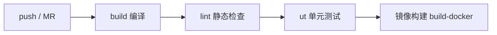

# 本地开发环境规范

> 状态：生效 | 维护者：jackz | 最后更新：2026-11-23（sop.init 填实）

## 范围

新人 30 分钟内跑通本服务的最低要求。所有命令必须经过验证。

## 系统要求

| 项目 | 要求 |
|------|------|
| 操作系统 | macOS / Linux（macOS 需 Xcode 15+ 链接器参数，Makefile 已处理） |
| 内存 | ≥8GB |
| 磁盘 | ≥20GB 空闲（go-ethereum 等依赖较大） |

## 必装依赖

```bash
# 1. 语言运行时（必装 go1.22.7，与 go.mod 一致）
go install golang.org/dl/go1.22.7@latest && go1.22.7 download

# 2. 数据库 / 中间件（推荐 Docker 起）
docker run -d --name cis-pg -e POSTGRES_PASSWORD=xxx -p 5432:5432 postgres:14
docker run -d --name cis-redis -p 6379:6379 redis:7

# 3. 开发工具
brew install protoc golangci-lint mockgen gocloc
go install google.golang.org/protobuf/cmd/protoc-gen-go@v1.32.0
go install google.golang.org/grpc/cmd/protoc-gen-go-grpc@v1.3.0
# goctl（go-zero 代码生成）：go install github.com/zeromicro/go-zero/tools/goctl@latest

# 4. 前端（web/）
node 20+，web/ 下 npm install
```

**版本一致性**：本仓库锁定 **Go 1.22.7**，禁用其他版本（CI 与本地必须一致，否则编译/测试结果可能不可重现）。

## 仓库初始化

```bash
git clone <repo-url>
cd chain-interactive-service
go mod tidy
make gen-code        # 从 proto/.api 生成代码（可选，仓库已含生成物）
# 准备 etc/chaininteractive.yaml（DB DSN / Redis 地址），首次启动 AutoMigrate 建表
```

## 一键运行

```bash
make start-service
# 等效：go build -o ./bin/chain-interactive-service ./chaininteractive.go && ./bin/chain-interactive-service
```

预期输出：gRPC 监听 `:8085`（Mode dev 开 reflection）、HTTP Gateway `0.0.0.0:8080`、DevServer `:6061`（`/healthz` 可探活）；日志写入 `logs/`（按天切割，保留 7 天）。

## 常用 make 目标

| 命令 | 用途 |
|------|------|
| `make build` | 编译产物（版本 LDFLAGS 注入 `internal/version.go`） |
| `make lint` | golangci-lint 静态检查 |
| `make ut` | 单元测试（`go test -coverprofile cover.out ./...`） |
| `make gen-code` | 从 IDL（proto/.api）生成代码 |
| `make gen-mock` | mockgen 生成 chaininteractive mock |
| `make start-service` | 本地构建并运行 |
| `make gen-cert` | 生成 TLS 证书 |
| `make build-docker` | 构建并推送镜像（vendor 化 chainmaker SDK） |
| `make comment` | gocloc 注释率统计 |

> 本项目无独立 `make integration-test` / `make tools` / `make init-db` 目标（IT 依托测试环境部署，见 [integration_test.md](../integration_test/integration_test.md)）。

## IDE 推荐配置

- GoLand / VS Code + Go 插件
- 配置：保存时 goimports；`.golangci.yml` 已含 gofmt/goimports
- 前端：VS Code + ESLint / Prettier（`web/`）

## 调试

- 启动：IDE 直接 Run `chaininteractive.go`，或 `dlv debug ./chaininteractive.go`
- 远程调试端口：2345（dlv --headless）
- 日志位置：`logs/`（go-zero logx file 模式，按天切割）

## 常见问题（FAQ）

- **Q: `make build` 报版本错误？** A: 检查 `go version`，必须为 1.22.7。
- **Q: macOS 链接器 `-ldl` 重复警告？** A: Makefile 已自动加 `-Wl,-no_warn_duplicate_libraries`（Xcode 15+）。
- **Q: 端口被占用？** A: 检查 8085/8080/6061；优雅退出异常残留时 `lsof -i :8085` 后 kill。
- **Q: 数据库连不上？** A: 核对 `etc/chaininteractive.yaml` 的 `DatabaseConf.DSN`；AutoMigrate 建表失败看 DSN 用户权限。
- **Q: chainmaker SDK 拉取失败？** A: build-docker 流程含 ida 定制版 sdk replace（`go get chainmaker.org/chainmaker/sdk-go/v2@v2.3.8`）。

更多踩坑见 [failures.md](../failures.md)。

## CI/CD 与交付

### CI/CD 流水线

> 如项目未接入 CI/CD，可删除本节。

- 平台：Jenkins（团队标准；流水线配置不在本仓库，`scripts/ut_cover.sh` 含 Jenkins MySQL 上报逻辑）
- 流水线配置文件：仓库内无（<!-- TODO(sop.init) 如接入流水线后补充 Jenkinsfile 路径 -->）
- 触发方式：<!-- TODO(sop.init) 按实际填写 -->

流水线流程（按团队 Jenkins 约定）：



> 按实际流水线修改上图，保留 mermaid 格式便于渲染。

### Helm 包

> 如项目未使用 Helm，可删除本节。

| 项目 | 说明 |
|------|------|
| Helm Chart 仓库 | 本仓库内维护（`deploy/helm/`） |
| Chart 路径 | `deploy/helm/` |

Chart 目录结构：

```
deploy/helm/
├── Chart.yaml      # name: chain-interactive-service, version 0.1.0, type: application
├── values.yaml     # replicaCount 2；gRPC 9000 / gateway 8080；HPA 2-10（CPU 70% / Mem 80%）；PDB minAvailable 1
└── templates/      # K8s 资源模板（Deployment/Service/HPA/PDB/Ingress 可选）
```

> DB/Redis 为外部服务引用（`postgresql:5432` / `redis:6379`），Chart 无子依赖；探针基于 `/healthz`。

## 参考

- 项目介绍：[../README.md](../README.md)
- AI 协作入口：[../AGENTS.md](../AGENTS.md)
