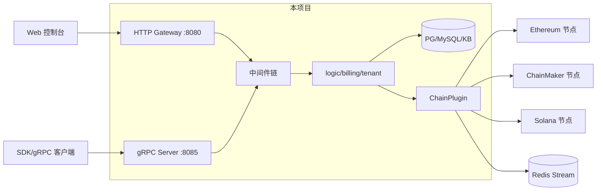

# 上下游 / 集成关系

> 本项目与外部世界的关系：谁在用它、它依赖了谁、依赖坏掉会怎样。
> 引入新外部依赖、调整调用拓扑、修改集成方式时同步更新。

> Source: go.mod 依赖 + `etc/chaininteractive.yaml` + `internal/sdk/` 各链客户端 + `deploy/helm/values.yaml`
> Last-verified: 2026-11-23

---

## 上游（谁在用本项目）

| 调用方 / 集成方 | 代码仓库 | 用途 | 协议 / 集成方式 | 关键入口 | 联系人 |
|-----------------|---------|------|-----------------|---------|-------|
| Web 管理控制台 | 本仓库 `web/` | 租户/链/合约配置、账单、仪表盘 | HTTP REST（axios） | `web/src/services/` → `/api/v1` | jackz |
| 业务方 SDK 客户端（Go/JS/Python/Java） | 外部 | 合约调用/交易查询/事件消费 | gRPC（`proto/chaininteractive.proto`） | `:8085` | jackz |

---

## 下游（本项目用了谁）

| 被调方 / 被依赖方 | 代码仓库 | 用途 | 协议 / 集成方式 | 关键入口 | SLA / 版本约束 | 失败处理 | 集成代码位置 |
|-------------------|---------|------|-----------------|---------|---------------|------------------------------|--------------|
| ChainMaker 节点 | `chainmaker.org/chainmaker/sdk-go/v2` v2.3.8 | 合约调用/交易/事件订阅 | gRPC（SDK 封装，节点地址存 DB 租户链配置） | `internal/sdk/chainmakerclient.go` | 长安链 2.3.x | error 返回，logic 层转 errcode | `internal/sdk/chainmakerclient.go` |
| Ethereum 节点 | `github.com/ethereum/go-ethereum` v1.14.11 | 合约调用/事件订阅 | JSON-RPC / WebSocket（断线降级重连，踩坑 `bc6c7746`） | `internal/sdk/ethereumclient.go` | — | WS 降级处理 | `internal/sdk/ethereumclient.go` |
| Solana 节点 | `github.com/gagliardetto/solana-go` v1.8.3 | 合约调用/事件订阅 | JSON-RPC + Borsh 编解码 | `internal/sdk/solanaclient.go` | — | error 返回 | `internal/sdk/solanaclient.go` / `solana_codec.go` |
| PostgreSQL / MySQL / Kingbase | — | 租户/账单/审计/调用日志持久化 | GORM（DSN 在 `etc/chaininteractive.yaml`） | `internal/store/db.go` | helm 默认 `postgresql:5432` | 启动失败即退出 | `internal/store/` |
| Redis | — | 事件推送 Stream + 订阅断点 KV | `jackz-jones/common/event`（node/cluster/sentinel） | `SubscribeConf` | 6.x/7.x | 启动失败即退出 | `internal/sdk/*client.go`、`internal/svc/` |
| 公共库 common | `github.com/jackz-jones/common` | db/event/grpc 封装 | Go module 依赖 | — | v0.0.0-20260603 | — | 多处 import |
| 镜像仓库 | `192.168.1.2:5000` | 服务镜像托管 | Docker registry | Makefile build-docker | — | — | `Makefile` |

---

## 调用关系说明

### 1. 合约调用链

- **触发场景**：客户端 gRPC `CallContract` 或 HTTP `POST /api/v1/contract/call`
- **调用拓扑**：`客户端` ─→ `中间件链(Auth→RBAC→RateLimit→Quota→Audit)` ─→ `logic` ─→ `TenantSDKManager` ─→ `ChainPlugin` ─→ `链节点`
- **传输数据**：链名+合约名/地址+方法+参数 → TxResponse；CallLog 异步落库
- **关键代码**：`internal/logic/grpc/callcontractlogic.go`、`internal/logic/http/chain/callContractLogic.go`
- **失败影响**：链节点不可达 → 该链租户调用全失败（errcode 5xxx）；Quota 拦截 → 403/配额错误
- **相关文档**：`proto/chaininteractive.proto`

### 2. 事件订阅链

- **触发场景**：`POST /api/v1/events/subscribe-by-contract` 开启订阅；`sdk.StartSubscribe` 启动时按 DB 配置恢复
- **调用拓扑**：`订阅配置(DB)` ─→ `链客户端` ─→ `Redis Stream` ─→ `gRPC 服务端流 SubscribeContractEvents` ─→ `消费端`
- **传输数据**：合约事件 → ContractEventResponse；断点高度存 Redis（`Get/SetLatestBlockHeight`）
- **关键代码**：`internal/sdk/helper.go`、`internal/logic/grpc/subscribecontracteventslogic.go`
- **失败影响**：Redis 故障 → 事件推送中断（断点保丢）；多副本未启用 Leader 选举 → 可能重复订阅
- **相关文档**：`doc/architecture_cn.md` §事件订阅

### 3. 租户计费链

- **触发场景**：每日 cron + 实时用量统计
- **调用拓扑**：`cron(billing)` ─→ `Quota/CallLog(DB)` ─→ `Bill 生成` ─→ `dashboard 查询`
- **传输数据**：日/月用量 → 账单（`idx_bill_tenant_period`）
- **关键代码**：`internal/billing/service.go`、`internal/svc/servicecontext.go`（cron 注册）
- **失败影响**：计费定时任务失败 → 账单缺失（踩坑 `266380d4`：时区/半开区间已修复）
- **相关文档**：`.harness/docs/sqls/database.md`

---

## 拓扑图

---

## 故障传播矩阵

| 下游 / 外部条件 | 受影响功能 | 失败表现 | 是否可降级 | 降级 / 兜底方案 |
|----------------|-----------|---------|-----------|----------------|
| ChainMaker 节点不可达 | 该链合约调用/订阅 | errcode 5xxx，链状态接口标 unhealthy | 否（核心功能） | 租户可在控制台 `test-connection` 预检 |
| Ethereum WS 断线 | 事件订阅中断 | 重连日志 | 是 | WS 自动降级重连（`bc6c7746` 修复） |
| Solana RPC 超时 | 该链调用失败 | errcode 5xxx | 否 | — |
| PostgreSQL 故障 | 全部写操作（租户/账单/审计） | 服务启动失败 / 5xx | 否 | K8s 探针重启 Pod |
| Redis 故障 | 事件推送与断点 | 订阅中断；**核心调用不受影响**（限流为进程内） | 部分 | 服务仍可用，恢复后从断点续传 |
| 镜像仓库不可达 | 发布流程 | build-docker 失败 | 否 | 运维修复 |
